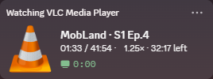
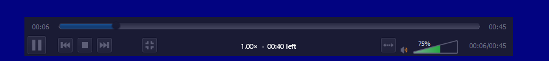

<div align="center">

# WatchKit for VLC

**Discord Rich Presence, precise playback speed, and bookmarks for VLC on Windows.**

[](#install)
[](docs/INSTALL.md#requirements)
[](LICENSE)

[Download for Windows](https://github.com/smilekritik/vlc-watchkit/releases/latest) · [Install](#install) · [Discord setup](docs/DISCORD.md) · [Shortcuts](#default-shortcuts) · [Playback and bookmarks](#playback-and-bookmarks) · [WatchKit for Chrome](https://github.com/smilekritik/browser-watchkit)

</div>

VLC loads WatchKit automatically when it opens, including when a file is opened from Explorer. The plugin runs inside VLC and exits with it.

## WatchKit for Chrome and VLC

Use the same Discord application in both editions. Enter the same **Application ID** in Chrome and VLC to publish playback under one name on your Discord profile. You only need to create the application once. [WatchKit for Chrome](https://github.com/smilekritik/browser-watchkit)

With VLC 1.1.3 and Chrome 1.5.1 or later, playing media in VLC takes priority over Chrome. Playing browser media takes over when VLC pauses or stops. If both have paused media, VLC keeps the card.

## Screenshots



Discord shows what you're watching and how much time is left at the current playback speed.



The fullscreen controls show speed and time remaining alongside VLC's usual playback controls.

## Install

1. Install [VLC 3.0.24 x64](https://download.videolan.org/vlc/3.0.24/win64/vlc-3.0.24-win64.exe) on Windows 10 or 11 x64, then close VLC.
2. Under **Assets** on the [latest release](https://github.com/smilekritik/vlc-watchkit/releases/latest), download the Windows x64 ZIP. Right-click the ZIP and choose **Extract All**.
3. In the extracted folder, double-click **Install WatchKit.bat** and approve the Windows administrator prompt if it appears. Setup uses Windows PowerShell.
4. When setup reports success, open VLC and choose **View > WatchKit Settings**.

See [Installation and removal](docs/INSTALL.md) for updating, building from source, custom paths, and troubleshooting.

## Light and dark themes

The playback overlay, resume prompt, bookmark windows, and settings adapt to VLC's light or dark palette. Close VLC and run the command for your preferred theme in a regular PowerShell 7 window from the project folder:

```powershell
./scripts/set-vlc-theme.ps1 -Theme Dark
./scripts/set-vlc-theme.ps1 -Theme Light
```

Run one command, then reopen VLC. Dark mode uses VLC's dark palette and Qt Fusion for the standard menus and controls. Light mode restores VLC's system style. See [Theme setup](docs/INSTALL.md#change-vlcs-theme).

## Default shortcuts

| Shortcut | Action |
| --- | --- |
| Page Up / Page Down | Increase or decrease video speed by 0.05× |
| Home | Set video speed to 1.00× and remember it |
| NumPad + / NumPad − | Use a large speed step |
| T | Show speed, real time remaining, and expected finish time |
| NumPad * | Toggle Discord Rich Presence and remember the choice |
| NumPad 9 | Pause and add a timestamped bookmark with a comment |
| Ctrl+NumPad 9 | Browse all saved bookmarks |

To change a shortcut, double-click its row in **View > WatchKit Settings**, press the new combination, then click **Save**. **Restore defaults** resets the shortcut list. Shortcuts apply when a VLC player window has focus. Matching shortcuts take priority over VLC's original actions.

Turn on Num Lock for the default bookmark shortcuts.

## Playback and bookmarks

VLC remembers the last video speed you set with the shortcuts or the Playback menu. New videos use the saved speed, including videos in a playlist and videos opened after a restart. Page Up/Down change speed by 0.05× down to 0.05×. NumPad + and − change speed by 0.50× in the middle of the range. NumPad − halves speeds below 1× and from 8× upward. NumPad + doubles speeds from 4× upward. VLC caps playback at 31.25×. The bottom toolbar and fullscreen controls show playback speed and the real time left. Click the speed to enter a custom value from 0.03× to 31.25×.

If VLC is idle, opening a video from File Explorer starts it. If a video is playing or paused, opening another file appends it to the queue. When a single local video is playing, the addon can queue consecutive episodes in its folder. It matches names like `Show Name S01E03.mkv` and `Show.Name.S01E04.1080p.mp4`. It stops at the first missing or ambiguous episode and follows the order of any playlist you already opened.

If you reopen an unfinished video, it plays from the beginning while a centered prompt offers to continue from your last position. You can close that prompt and keep watching from the beginning. Start VLC without a file to see the latest available unfinished video, or use **View > WatchKit Continue Watching** when the player is idle.

NumPad 9 captures the timestamp, pauses a playing video, and opens the comment window. **Save** or **Cancel** returns you to playback if the video was playing before. **All bookmarks** supports search, editing, and opening the saved moment. If a file is deleted or moved, the bookmark still shows the title, time, and comment.

## Discord

Discord sharing is optional. Follow [Discord setup from scratch](docs/DISCORD.md) to create an application, copy its public Application ID, add optional artwork, and verify your first status using the Discord desktop app.

The card shows the video title, episode, current position, duration, speed, and remaining time at that speed. On pause, a ⏸ icon appears and the playback times freeze. Press **NumPad `*`** to clear the card and keep sharing off until you turn it back on. Stopping or closing VLC also clears the card. Viewing history and bookmark comments stay on your computer. Optional [frame previews](docs/DISCORD.md#show-preview-images) send individual frames to an uploader you configure.

## Contributing

See [Architecture and tests](docs/DEVELOPMENT.md) for the source layout, build, and test commands. Run `./scripts/build.ps1 -Test` before opening a pull request. For playback, theme, or Discord changes, include the manual checks you ran.

Report bugs with your Windows and VLC versions, active theme, reproduction steps, and relevant lines from VLC's **Tools > Messages** window. Remove private filenames and paths from shared logs.

Released under the [GNU General Public License v2.0 or later](LICENSE). WatchKit is an independent project for VLC media player.
