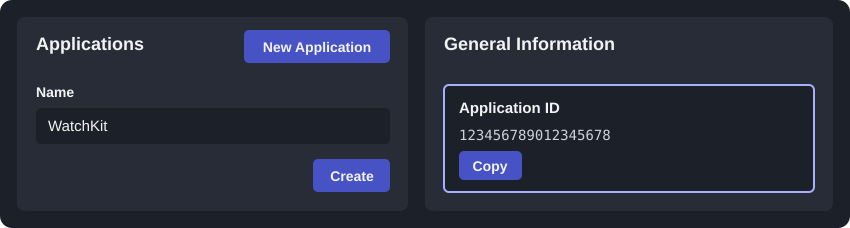
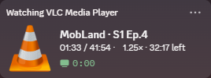

# Set up Discord Rich Presence

Install WatchKit for VLC, then follow the steps below to get your Application ID. [Installation guide](INSTALL.md)

If you also use WatchKit for Chrome on the same Windows account, you can reuse your VLC setup from **Settings → Discord → Import ID from WatchKit for VLC**. If you set up Chrome first, paste its Application ID into VLC. [WatchKit for Chrome setup](https://github.com/smilekritik/browser-watchkit#connect-discord-in-chrome)

## Get a Discord Application ID

Use the same Application ID for WatchKit in Chrome and VLC. If you already have a Discord application for WatchKit, open it and skip to step 3.

1. Sign in to the [Discord Developer Portal](https://discord.com/developers/applications) and choose **New Application**.
2. Enter `WatchKit` as the name and click **Create**. Discord uses that name in the activity heading.
3. In your application's sidebar, open **General Information**. Find **Application ID** and click **Copy**.



The Application ID is public. You can set up Rich Presence with the ID alone, without creating a bot or copying a token. For optional fallback artwork, upload an image under **Rich Presence → Art Assets** in that application and copy its asset key.

## Connect VLC

1. Open the Discord desktop app and sign in.
2. In VLC, open **View → WatchKit Settings**.
3. Paste the **Application ID**. If you uploaded an asset, enter its key in **Large image key**.
4. Enable **Share playback and pause status** and click **Save**.
5. Start a video, then open your Discord profile to check the activity.

If the card is missing, open Discord's **User Settings → Activity Privacy** and enable activity sharing. Check that WatchKit has the Application ID from **General Information**.



The card heading comes from the name you registered in the Developer Portal. The episode and timing lines update as the video plays.

**NumPad `*`** switches publication on or off. The video title line ends in ⏸ when paused. The remaining time stays fixed while paused and updates again when playback resumes. Discord controls how this activity is ranked alongside games and other apps. If the desktop client is closed, the addon reconnects during active playback when Discord becomes available.

## Troubleshooting

- **No card.** Keep the Discord desktop client signed in, check activity sharing, and verify the public Application ID in VLC. Start playback and check your profile. Discord's browser client can display the card once the desktop client publishes it.
- **No artwork.** Test the connection with the image key blank, then check that the key belongs to the same application. A new asset can take time to appear.
- **A different activity appears first.** Discord decides which activity to display alongside games and streams. Check your full profile for the VLC activity.

[Discord's direct Rich Presence documentation](https://docs.discord.com/developers/discord-social-sdk/development-guides/setting-rich-presence#rich-presence-without-authentication)

## Playback information

The first line below the application name shows the video title and episode label when available. The next line shows the current position, total duration, playback speed, and estimated time remaining. It uses monospaced Unicode digits to reduce horizontal shifting as the numbers change. The addon sends the position and remaining time together about every five seconds during playback. Seeks and speed changes update the card as soon as the Discord update budget allows.

## Show preview images

To share frames automatically, enter your uploader's URL in **Video frame upload URL**. WatchKit takes the current frame from VLC's video output during local video playback, at most once every 60 seconds. It sends a proportional JPEG with a longest side of 512 pixels. On pause the card keeps the last frame.

The uploader must accept an HTTPS `POST` with a raw `image/jpeg` body and return a successful response containing only the public HTTPS image URL as text. Serve a distinct image URL for each frame so Discord can fetch the new image. WatchKit has no built-in upload service. Leave the field blank to disable uploads. Only configure a server where you want to send frames from your local videos.

To rotate preview images, put an optional UTF-8 text file next to the video. For `Episode.mp4`, name it `Episode.mp4.discord-previews.txt`. List the video minute (starting at zero) followed by a space and a Discord asset key or a public HTTPS image URL:

```text
0 opening_scene
1 https://your-image-host.example/episode/minute-01.jpg
2 https://your-image-host.example/episode/minute-02.jpg
```

Use stills you have permission to share. You supply and host the images. The addon reads the list once per video and uses the configured VLC icon for minutes without an image. Review the URLs before enabling Discord sharing for a video you received from someone else.
