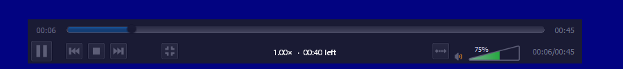

# Installation and removal

## Requirements

- Windows 10 or 11, x64.
- [VLC 3.0.24 x64 installer](https://download.videolan.org/vlc/3.0.24/win64/vlc-3.0.24-win64.exe). The plugin builds against this version's internal module API.
- PowerShell 7 and internet access to download the pinned build dependencies. The build script uses the Windows versions of curl and tar.

## Prepare the scripts

Clone the repository with Git or extract it using **Code > Download ZIP**. Open PowerShell 7 (`pwsh`) in the folder containing `README.md` and `scripts`.

Windows may mark the extracted scripts as downloaded files. If PowerShell reports that a script is unsigned, review the scripts and unblock them from the project folder. [PowerShell execution policies](https://learn.microsoft.com/en-us/powershell/module/microsoft.powershell.core/about/about_execution_policies)

```powershell
Get-ChildItem -LiteralPath ./scripts -Filter *.ps1 -File | Unblock-File
```

## Build and install

From PowerShell 7 in the repository root:

```powershell
./scripts/build.ps1 -Test
```

The first build downloads about 180 MiB into `.deps`, verifies the checksums, and writes `build/libvlc_addon_plugin.dll`. Close VLC. Under the Windows account that will use VLC, open PowerShell 7 as administrator, return to the project folder, and run the installer.

```powershell
./scripts/install.ps1
```

If your VLC is in a custom folder, pass the same path to both scripts:

```powershell
./scripts/build.ps1 -VlcDirectory 'D:\Apps\VLC' -Test
./scripts/install.ps1 -VlcDirectory 'D:\Apps\VLC'
```

Make VLC the default Windows app for the video extensions you want to open from File Explorer. The installer registers the module for the current user, enables single-instance enqueue, and replaces VLC's resume prompt with the addon's. Find the addon's settings and bookmark list in **View**.

## Change VLC's theme

Close VLC and run one of these commands from a regular PowerShell 7 window in the repository root:

```powershell
./scripts/set-vlc-theme.ps1 -Theme Dark
./scripts/set-vlc-theme.ps1 -Theme Light
```

Reopen VLC after running the command. Dark mode uses VLC's built-in dark palette with Qt's Fusion style for menus and playback controls. Light mode restores VLC's default system style. WatchKit follows the selected palette in the standard Qt interface, including the playback overlay, resume prompt, bookmark windows, and settings.



## Back up or remove the addon

Close VLC and run `./scripts/uninstall.ps1` in an administrator PowerShell 7 window. Pass `-VlcDirectory` if you installed into a custom folder. The script removes the addon and restores the managed VLC options when they still match the installed values.

Back up `%LOCALAPPDATA%\VLCAddon` to keep your settings, bookmarks, and viewing positions. Uninstalling leaves those files in place. To remove your data too, delete that folder after uninstalling.

## Troubleshooting

- If the addon's menu is missing, close VLC, rerun the installer, and restart VLC. Confirm that you are using the default Qt interface.
- If the menu exists but its items do nothing, open **Tools > Messages** with verbosity 2. Look for `VLC WatchKit loaded` or errors from `vlc_addon`.
- If VLC cannot load the module after an upgrade, uninstall the addon before upgrading or use the pinned VLC version until the addon supports the new release.
- If a JSON file becomes unreadable, close VLC and copy the file somewhere safe before fixing or moving it. The addon preserves unreadable files and turns Discord publication off if it cannot read settings.
